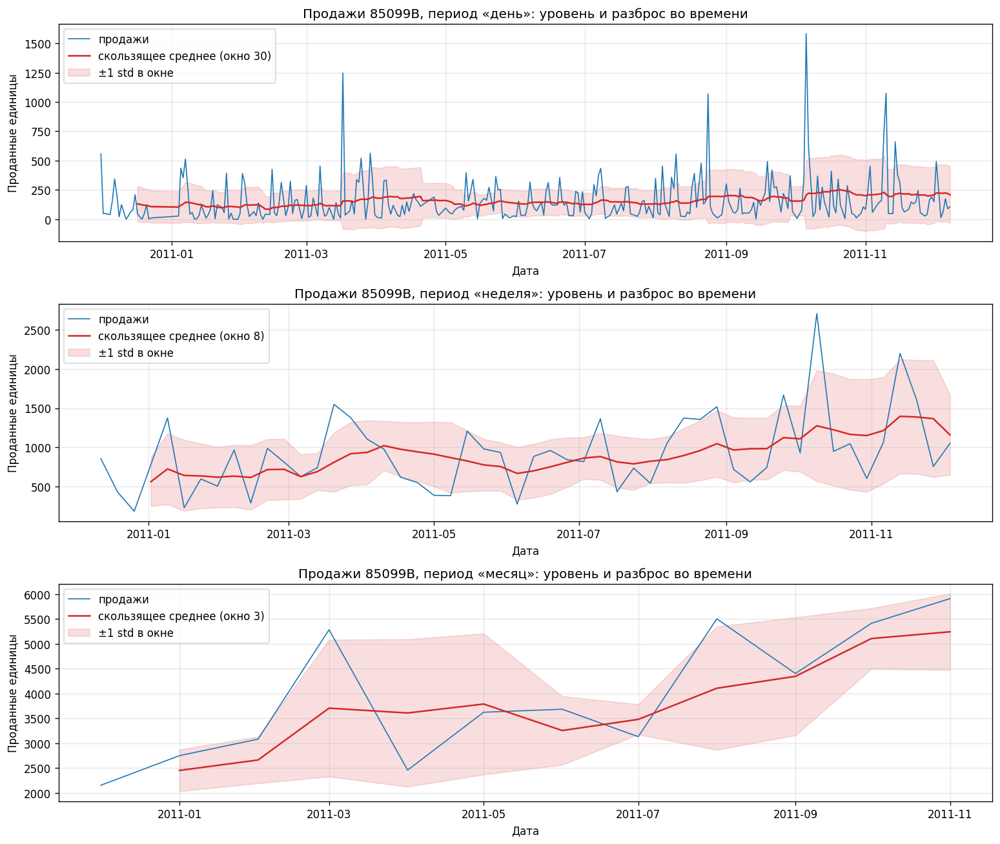
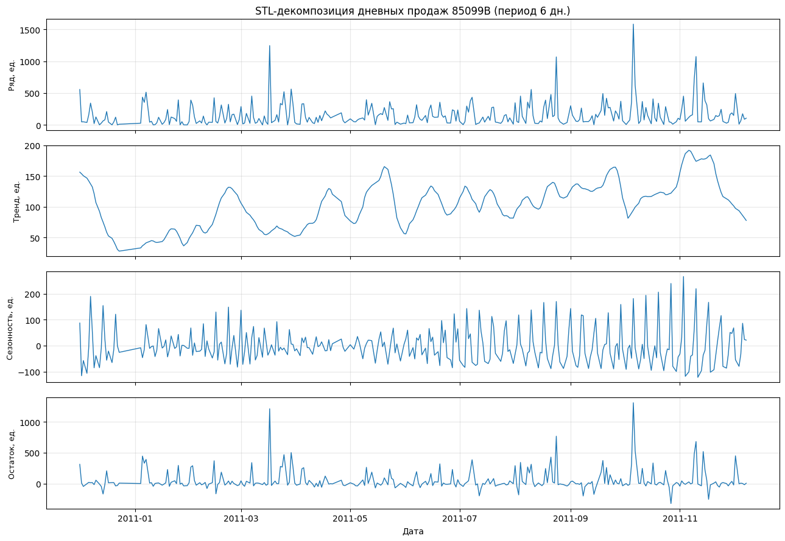

# Прогнозирование продаж: анализ и предобработка временного ряда

Домашнее задание 1 по курсу «Прогнозирование временных рядов и обработка сигналов».

Анализируется временной ряд продаж товара **85099B** (JUMBO BAG RED RETROSPOT) из датасета
[Online Retail (UCI)](https://archive.ics.uci.edu/dataset/352/online+retail). На лекции разбирался
другой товар (85123A). Показатель продаж: количество проданных штук (`Quantity`), возвраты
(счета на `C`) и строки с `Quantity <= 0` в расчёт не входят.

Весь ход анализа, графики и интерпретации находятся в `sales_analysis.ipynb`, а методы лежат в
`src/ts_tools.py`: ноутбук только вызывает функции.

## Что сделано

1. **Ряд.** Продажи агрегированы по дням, неделям и месяцам. Неполные периоды по краям
   (данные заканчиваются 9 декабря 2011 посреди дня) отброшены.
2. **Качество данных.** Диагностика пропусков и выбросов, обоснование решений, график ряда до обработки.
3. **Описательный анализ.** Статистики, скользящие среднее и разброс, тренд, тип спроса (ADI / CV²).
4. **Декомпозиция.** STL (основной метод) и классическая аддитивная для сравнения; сезонность
   проверена четырьмя способами.
5. **Стационарность.** Тесты ADF и KPSS, подбор преобразования, повторная проверка.
6. **Функции.** Все методы вынесены в `src/ts_tools.py`, воспроизводимость проверена
   (`build_series` собирает те же ряды одним вызовом).

## Выводы

**Ряд и качество данных.** Получилось 373 дневных наблюдения (304 после перехода на торговый
календарь), 52 недельных и 12 месячных. Пустых дней 73 из 373, но 69 из них магазин вообще не
работал (53 субботы и 16 праздничных дней, например 24 декабря - 3 января). Это отсутствие
наблюдения, а не нулевой спрос, поэтому нулями я эти дни не заменял, а убрал из дневного ряда.
Настоящих нулей всего 4 (магазин работал, а товар не купили). В недельном ряду одна пустая неделя
(рождественский перерыв), она интерполирована.

**Выбросы.** IQR отметил 14 точек, MAD 15, остаток STL 60 (слишком много: метод чувствителен к
тяжёлому хвосту). Минимум два метода согласились на 15 днях. В трёх самых больших днях
(6 октября, 17 марта, 10 ноября) 63-96 % продаж приходится на один круглый заказ в 1000-1200 штук,
то есть это оптовые заказы, а не ошибки. Выбросы я не удалял. Для проверки устойчивости построил
версию с ограничением сверху (751 штука, изменено 4 дня из 304), вывод по стационарности на ней тот же.

**Описательный анализ.** Дневные продажи в среднем 159 штук при медиане 106, сильно скошены вправо
(скошенность 3,2), коэффициент вариации 1,19. При укрупнении периода ряд спокойнее (CV 0,52 по неделям,
0,33 по месяцам). Спрос «нерегулярный» по Syntetos-Boylan (ADI = 1,01, CV² = 1,38): товар продаётся
почти каждый день, но размер заказа сильно прыгает. Уровень растёт к осени (по неделям +13 штук за
неделю, p = 0,003), разброс растёт вместе с уровнем (корреляция скользящих среднего и std по неделям
0,77).



**Сезонность.** Недельная сезонность с периодом 6 торговых дней (по субботам торговли нет)
статистически значима, но слабая: Краскел-Уоллис по дням недели p близко к 0 (воскресенье в среднем
около 56 штук, четверг около 220), в спектре самый высокий пик стоит на периоде 6 дней, ACF на лаге 6
равна 0,12 при границе 0,112, а сила сезонности STL всего 0,17. Размах сезонной составляющей растёт
вместе с уровнем продаж. Годовую сезонность по этим данным оценить нельзя: наблюдений чуть больше
года (нужно минимум два), и рост к осени неотличим от долгосрочного тренда.



**Стационарность.** У исходного дневного ряда ADF отвергает единичный корень (p < 0,001), а KPSS
отвергает стационарность (p = 0,023): тесты расходятся. То же на ряду без экстремумов и на недельном
ряду. Интерпретация: случайного блуждания нет, но есть медленно растущий уровень. Подбор
преобразования показал, что логарифм сам по себе не помогает, а первая разность делает оба теста
согласными:

| Ряд | Преобразование | ADF p | KPSS p | Вывод |
|---|---|---|---|---|
| дневной, исходный | нет | < 0,001 | 0,023 | тесты расходятся |
| дневной | первая разность | < 0,001 | ≥ 0,10 | стационарен |
| недельный, исходный | нет | < 0,001 | 0,016 | тесты расходятся |
| недельный | первая разность | 0,021 | ≥ 0,10 | стационарен |

Минус преобразования: после разности у дневного ряда появляется отрицательная автокорреляция на лаге 1
(-0,35, у исходного было +0,16), то есть ряд слегка переразностен. Для будущей прогнозной модели
стоит сравнить более мягкие варианты (вычитание сглаженного тренда, сезонная разность с лагом 6,
которая тоже проходит оба теста), а при необходимости стабилизировать разброс логарифмом.


## Ограничения

* Один год данных: нет годовой сезонности, тренд неотделим от осеннего (предрождественского) роста.
* Месячный ряд состоит из 12 точек, поэтому тесты стационарности для него не проводились.
* Не проверялось, были ли крупные оптовые заказы позже отменены отдельными счетами-возвратами.
* Тесты стационарности проводились только с константой, без варианта с трендом.

## Структура репозитория

```
.
├── sales_analysis.ipynb   # полный ход анализа, графики, интерпретация (с результатами запуска)
├── src/ts_tools.py        # функции анализа и предобработки
├── figures/               # графики из ноутбука
├── data/                  # сюда кладётся Online Retail.xlsx (в git не попадает)
├── requirements.txt
└── README.md
```

## Как запустить

```bash
python -m venv .venv
source .venv/bin/activate        # Windows: .venv\Scripts\activate
pip install -r requirements.txt
jupyter notebook sales_analysis.ipynb
```

Файл с данными скачивается автоматически при первом запуске. Если нет интернета, положите
`Online Retail.xlsx` в папку `data/`. Ноутбук выполняется сверху вниз, корень репозитория он находит
сам.
