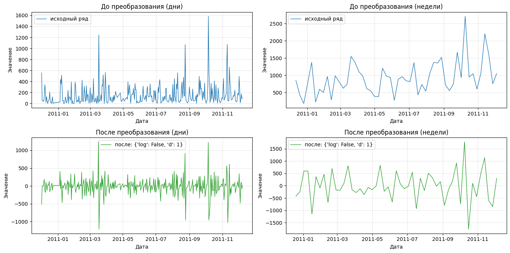

# Прогнозирование продаж: анализ и предобработка временного ряда

Домашнее задание 1 по курсу «Прогнозирование временных рядов и обработка сигналов».

Я анализирую ряд продаж товара **85099B** (JUMBO BAG RED RETROSPOT) из датасета
[Online Retail (UCI)](https://archive.ics.uci.edu/dataset/352/online+retail). На лекции разбирался
другой товар, 85123A. Показатель продаж: количество проданных штук (`Quantity`). Возвраты (счета на `C`)
и строки с `Quantity <= 0` в расчёт не входят.

Весь ход анализа, графики и интерпретации лежат в `sales_analysis.ipynb`, а методы в `src/ts_tools.py`:
ноутбук только вызывает функции.

## Что сделано

1. Отобрала товар и собрала ряд продаж по дням, неделям и месяцам. Неполные периоды по краям отбросила
   (данные заканчиваются 9 декабря 2011 посреди дня).
2. Проверила пропуски и выбросы, обосновала решения, построила график ряда до обработки.
3. Посчитала описательные статистики, скользящие среднее и разброс, тренд, тип спроса (ADI и CV²).
4. Сделала декомпозицию (STL и для сравнения классическую) и проверила сезонность четырьмя способами.
5. Проверила стационарность тестами ADF и KPSS, подобрала преобразование и повторила проверку.
6. Вынесла все методы в функции (`src/ts_tools.py`) и проверила воспроизводимость: `build_series`
   собирает те же ряды одним вызовом.

## Выводы

### Ряд и качество данных

Получилось 373 дня (304 после перехода на торговый календарь), 52 недели
и 12 месяцев. Пустых дней 73 из 373, но в 69 из них магазин не работал: 53 из этих дней субботы, остальные
похожи на праздничные перерывы (самый длинный с 24 декабря по 3 января, 11 дней). Это отсутствие
наблюдения, а не нулевой спрос, поэтому нулями я эти дни не заменяла, а убрала из дневного ряда.
Настоящих нулей всего 4. В недельном ряду одна пустая неделя в рождественский перерыв, её я интерполировала.

### Выбросы

IQR отметил 14 точек, MAD 15, остаток STL 60 (слишком много, метод чувствителен к тяжёлому
хвосту), минимум два метода согласились на 15 днях. В трёх самых больших днях почти весь объём даёт один
круглый заказ (1000 штук из 1583, 1200 из 1246, 1000 из 1074), это похоже на оптовые заказы, а не на ошибки.
Выбросы я не удаляла. Для проверки сделала версию с ограничением сверху (751 штука, изменено 4 дня из 304),
вывод о стационарности на ней тот же.

### Описание ряда

Среднее дневных продаж 159,4 при медиане 105,5, ряд сильно скошен вправо (скошенность 3,24),
коэффициент вариации 1,19. С укрупнением периода ряд спокойнее: 0,523 по неделям и 0,332 по месяцам. Спрос
нерегулярный по Syntetos-Boylan (ADI = 1,01, CV² = 1,38): товар продаётся почти каждый день, но размер
заказа сильно меняется. Уровень растёт к осени (по неделям +13,02 штуки за неделю, p = 0,003), а разброс
растёт вместе с уровнем (корреляция скользящего среднего и std по неделям 0,77).


### Сезонность

Недельная сезонность с периодом 6 торговых дней (по субботам магазин не торгует)
статистически значима, но слабая. Критерий Краскела-Уоллиса по дням недели даёт H = 46,96 и p, близкое
к нулю, самый высокий пик спектра стоит на периоде 5,96. Но сила сезонности STL всего 0,168, а ACF на лаге 6
равна 0,120 при границе 0,112, то есть едва выше неё. Размах сезонной составляющей растёт вместе с уровнем
продаж. Годовую сезонность по этим данным оценить нельзя: наблюдений чуть больше года, а нужно минимум два,
и рост к осени неотличим от долгосрочного тренда.


### Стационарность

У исходных рядов ADF отвергает единичный корень, а KPSS отвергает стационарность
(p от 0,016 до 0,023), то есть тесты расходятся. Я читаю это так: случайного блуждания нет, но есть медленно
растущий уровень. Логарифм ситуацию не меняет, а первая разность делает оба теста согласными:

| Ряд | Преобразование | ADF p-value | KPSS p-value | Вывод |
|---|---|---|---|---|
| дневной | нет | 0,000 | 0,023 | тесты расходятся |
| дневной | первая разность | 0,000 | 0,100 | стационарен |
| недельный | нет | 0,000 | 0,016 | тесты расходятся |
| недельный | первая разность | 0,021 | 0,100 | стационарен |

0,000 здесь результат округления до трёх знаков, а 0,100 это граница таблицы KPSS (p не меньше 0,10). Минус преобразования: на ACF
разностного ряда лаг 1 уходит заметно ниже доверительной полосы, а у исходного ряда там было положительное
значение 0,158. Это признак того, что ряд немного переразностен, поэтому для будущей модели стоит сравнить
более мягкие варианты (вычитание сглаженного тренда, сезонная разность с лагом 6, которая тоже проходит
оба теста).



## Ограничения

* Данных чуть больше года: годовую сезонность оценить нельзя, тренд неотделим от осеннего роста.
* В месячном ряду 12 точек, поэтому тесты стационарности для него я не делала.
* Не проверяла, были ли крупные заказы потом отменены отдельными счетами-возвратами.
* Тесты стационарности делала только с константой, без варианта с трендом.

## Структура репозитория

```
.
├── sales_analysis.ipynb   # ход анализа, графики, интерпретация (с результатами запуска)
├── src/ts_tools.py        # функции анализа и предобработки
├── figures/               # графики из ноутбука
├── data/                  # Online Retail.xlsx (в git не попадает) и csv с рядами продаж
├── requirements.txt
└── README.md
```

В `data/` ноутбук сохраняет очищенные ряды: `sales_85099B_daily.csv`, `sales_85099B_weekly.csv`
и `sales_85099B_monthly.csv`.

## Как запустить

```bash
python -m venv .venv
source .venv/bin/activate        # Windows: .venv\Scripts\activate
pip install -r requirements.txt
jupyter notebook sales_analysis.ipynb
```

Файл с данными скачивается автоматически при первом запуске. Если интернета нет, положите
`Online Retail.xlsx` в папку `data/`. Ноутбук выполняется сверху вниз, корень репозитория он находит сам.
